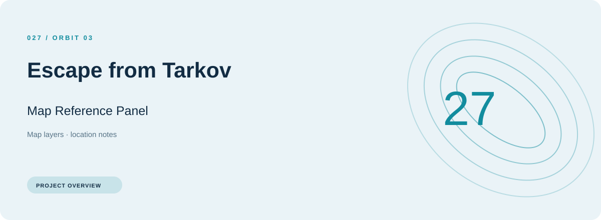
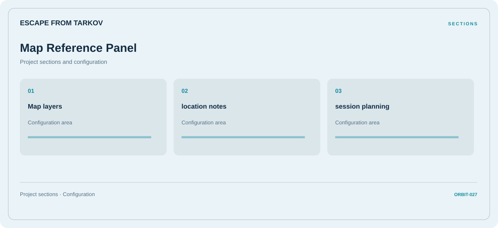

# 🧭 Escape from Tarkov Map Reference Panel

**Map layers · Location notes · Session planning**

## ⚡ Features

The Escape from Tarkov map reference panel workflow separates map layers from location notes and session planning. Named sections make the available options easier to find.

### ⚙️ Map layers

A dedicated section for map layers and the configuration details associated with that area.

### 🧩 Location notes

A dedicated section for location notes and the configuration details associated with that area.

### ⌨️ Session planning

Session and activity information grouped by the task or context it belongs to.

## 🖥️ Project navigation

## 📥 Download

The button and cover open the project's download page. Use the information supplied with the downloaded package for installation and release-specific requirements.

## 📚 Project documentation

- [Feature reference](docs/FEATURES.md)
- [Download information](docs/DOWNLOAD.md)
- [Project page](index.html)

---

Escape from Tarkov Map Reference Panel · Program documentation and download information.
